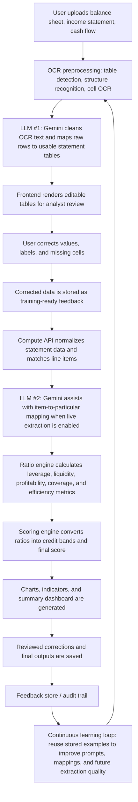
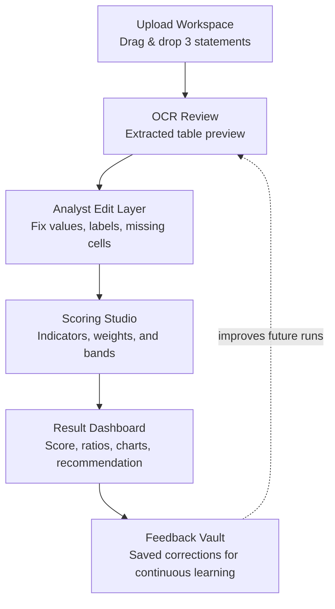
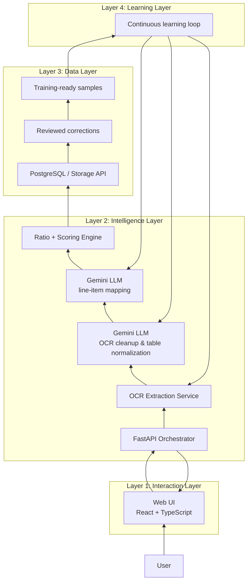

# Slide 01: Team Details

**Team Name:** OnneshX  
**Team Leader Name:** [Leader Name]  
**Problem Statement:**  
Manual credit analysis is slow, error-prone, and highly repetitive. Financial statements arrive in scanned images or PDFs, and analysts must extract values, verify them, compute ratios, and prepare a credit view. This project automates that entire journey.

---

# Slide 02: Brief About the Idea

Our project is an **AI-powered Credit Risk Rating System** that turns raw financial documents into a structured credit assessment.

The system:
- accepts balance sheet, income statement, and cash flow statement files,
- extracts data through OCR and document parsing,
- allows the user to review and edit extracted values,
- computes financial ratios and scoring metrics,
- generates a final credit rating with charts and summaries.

In the live extraction path, we use the **Gemini AI API** to clean OCR output, normalize text, and match statement line items more accurately.

What makes it practical is that it does not fully remove the human from the loop. Instead, it gives analysts a fast, guided workflow where automation handles the heavy lifting and the user remains in control of the final numbers.

---

# Slide 03: Opportunities

## Why this idea stands out
Most existing solutions do one of these:
- only extract text,
- only calculate ratios,
- only visualize data,
- or require heavy manual correction.

This project combines all four into one workflow.

## How it solves the problem
- It reduces manual data entry.
- It shortens the time needed for financial review.
- It improves consistency across credit assessments.
- It preserves analyst judgment through editable data tables.

## USP of the solution
- End-to-end pipeline from document upload to credit score.
- Editable extraction results, not just raw OCR output.
- Modular architecture that can scale from prototype to production.
- Ready for both saved-response mode and live OCR/LLM mode.

---

# Slide 04: Process Flow Diagram

## Flow explanation
1. User uploads the three financial statements.
2. The OCR service detects tables, reads cells, and produces structured markdown/JSON-like output.
3. Gemini is used first to clean noisy OCR output and align it with a usable table structure.
4. The frontend shows editable statement tables so the analyst can verify or correct values.
5. The compute API prepares the statements for scoring and, when live mode is enabled, uses Gemini a second time to map line items to the correct financial particulars.
6. Ratios are calculated from the cleaned values and passed into the scoring engine.
7. The system generates the final rating, graphs, and summary, then stores the reviewed data, corrections, and outputs.
8. The corrected records are saved as training-ready examples for later improvement.
9. The saved examples feed a continuous learning loop that helps refine future extraction, mapping, and scoring behavior.

---

# Slide 05: Wireframes / Mock Diagrams

## UI concept
- Upload workspace: a focused entry point for the three documents.
- OCR review: side-by-side extracted tables for quick validation.
- Analyst edit layer: the reviewer can correct numbers before scoring.
- Scoring studio: weights, indicators, and thresholds live here.
- Result dashboard: score, graph, and explanation in one view.
- Feedback vault: stores corrections for future improvement.

---

# Slide 06: Architecture Diagram

## Architecture explanation
- **Layer 1, Interaction:** the reviewer uploads statements and edits extracted values in the browser.
- **Layer 2, Intelligence:** the API coordinates OCR, Gemini-based cleanup, Gemini-based mapping, and scoring.
- **Layer 3, Data:** the system stores reviewed corrections, audit history, and trainable examples.
- **Layer 4, Learning:** saved corrections feed a feedback loop that improves future extraction and mapping quality.

This architecture keeps the system modular, testable, and production-friendly.

---

# Slide 07: Technologies to Be Used

## Frontend
- React
- TypeScript
- Vite
- Plotly
- Zustand

## Backend
- FastAPI
- Python
- Pydantic

## OCR and AI
- PaddleOCR for table extraction
- Gemini AI API for text cleanup, normalization, and line-item matching

## Data and Deployment
- PostgreSQL
- Docker
- Docker Compose
- Google Cloud Run for production deployment

---

# Slide 08: Estimated Implementation Cost

## Prototype phase
- Development tools: open source
- Dockerized local deployment: free
- Saved-response mode: free for testing
- No cloud hosting required initially

## Production phase
- Cloud Run: low cost for container hosting
- Cloud SQL: paid, but scalable
- Gemini API usage: depends on API calls during live extraction and text matching
- Storage and logging: minimal for small usage

## Cost strategy
- Start with saved responses.
- Use cloud only when needed.
- Keep OCR and scoring services modular to control cost.

---

# Slide 09: Snapshots of the Prototype

You can place screenshots here from the running app:

- Upload page
- OCR result page
- Editable tables page
- Ratio calculation page
- Summary dashboard
- Graphs and charts page

## Suggested caption style
- “Statement upload and extraction flow”
- “Editable OCR output with analyst review”
- “Final credit score with visual analytics”

---

# Slide 10: Prototype Performance Report / Benchmarking

## Performance areas
- OCR extraction accuracy
- Table structure recognition
- Ratio computation correctness
- End-to-end response time
- UI responsiveness

## Benchmark format

| Metric | Expected Result | Notes |
|---|---:|---|
| Upload to extraction time | [fill] sec | Depends on file size |
| Table parsing success rate | [fill]% | Based on sample statements |
| Ratio computation time | [fill] sec | Very fast after extraction |
| Final score generation | [fill] sec | Includes scoring and charts |
| Manual correction time saved | [fill]% | Compared to manual workflow |

## Why this matters
This project is valuable because it is not just functional, it is measurable. The system can prove speed, consistency, and usability.

---

# Slide 11: Additional Details / Future Development

## Future enhancements
- PDF support for multi-page statements
- Stronger OCR confidence scoring
- Better handling of messy or non-standard bank layouts
- Automated audit trail for edits
- Role-based access for analysts and reviewers
- Cloud deployment with monitoring and logging

## Long-term vision
This project can evolve into a full financial intelligence platform where document extraction, validation, scoring, and reporting happen in one place.

---

# Slide 12: Links

- **GitHub Public Repository:** [Paste link here]
- **Demo Video Link (3 Minutes):** [Paste link here]
- **Final Product Link:** [Paste link here]
